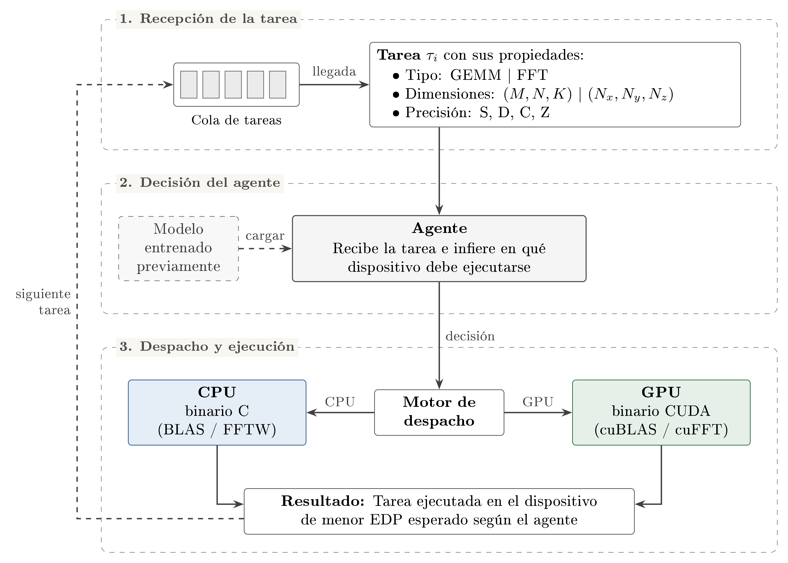

<p align="left">
  
  &nbsp;&nbsp;&nbsp;&nbsp;
  
  &nbsp;&nbsp;&nbsp;&nbsp;
  
</p>

# Planificador de Tareas CPU-GPU basado en Aprendizaje por Refuerzo para la Optimización del EDP

**Diseño, Implementación y Evaluación de un Planificador de Tareas Basado en Aprendizaje por Refuerzo para la Optimización del Producto Energía-Retardo (EDP) en Sistemas CPU-GPU.**

Trabajo de grado — **Universidad Industrial de Santander (UIS)**, Escuela de Ingeniería de Sistemas e Informática.
Mediciones y validación realizadas en el nodo heterogéneo `paccaA100` de la **Universidad de Cartagena**.

---

## Tabla de contenidos

1. [Información académica](#información-académica)
2. [Resumen](#resumen)
3. [Flujo de decisión del agente](#flujo-de-decisión-del-agente)
4. [Alcance](#alcance)
5. [Estructura del proyecto](#estructura-del-proyecto)
6. [Requisitos](#requisitos)
7. [Cómo ejecutar](#cómo-ejecutar)
8. [Formato de los datos](#formato-de-los-datos)
9. [Reproducibilidad](#reproducibilidad)

---

## Información académica

| | |
|---|---|
| **Universidad** | Universidad Industrial de Santander (UIS) |
| **Facultad / Escuela** | Escuela de Ingeniería de Sistemas e Informática |
| **Autores** | _[Nombre completo del autor 1]_ · _[Nombre completo del autor 2]_ |
| **Director** | _[Nombre completo del director]_ |
| **Grupos de investigación** | **CAGE** · **SC3** (Supercomputación y Cálculo Científico, UIS) |
| **Infraestructura de validación** | Nodo `paccaA100` de la Universidad de Cartagena — 2× Intel Xeon Gold 5315Y y 1× NVIDIA A100 |

---

## Resumen

Los nodos de Computación de Alto Rendimiento (HPC) combinan procesadores multinúcleo (CPU) y aceleradores (GPU). El dispositivo adecuado para cada tarea depende de su tamaño, su precisión y el costo de transferencia por el bus PCIe.

Este trabajo diseña, implementa y evalúa un planificador de tareas en espacio de usuario que asigna cada tarea a la CPU o a la GPU mediante un agente de Aprendizaje por Refuerzo (DQN, formulado como bandido contextual) para minimizar el Producto Energía-Retardo (EDP). Se caracterizaron la multiplicación de matrices (GEMM) y la Transformada Rápida de Fourier (FFT 1D, 2D y 3D) en un nodo con dos Intel Xeon Gold 5315Y y una NVIDIA A100, midiendo la energía con RAPL y NVML. El agente se entrenó fuera de línea sobre 21 844 tareas medidas, con una recompensa normalizada por el EDP del peor dispositivo.

Evaluado sobre el mismo conjunto de entrenamiento, el agente elige el dispositivo de menor EDP en el 97.26 % de las tareas, y en el 97.22 % de las tareas de tamaños no medidos dentro de los rangos caracterizados, un desempeño comparable al de un clasificador supervisado entrenado con los mismos rasgos. En una cola de 200 tareas reduce el EDP de sistema un 92.8 % respecto de ejecutar todo en la CPU, queda a 0.03 % del oráculo por tarea y empata con la ejecución exclusiva en la GPU y con la heurística MET (diferencias inferiores al 0.3 %). Las heurísticas MCT y Min-Min, que observan la ocupación de las colas, obtienen un EDP de sistema entre 3.9 % y 5.7 % menor. La política aprendida iguala a las heurísticas que disponen de la misma información, pero no supera a las que explotan el paralelismo entre dispositivos.

### Fases del proyecto

| Fase | Módulo | Contenido |
|---|---|---|
| 1 | Benchmark (`benchmark_runner.py`, `algoritmos/`, `bench_files/`) | Caracterización de tiempo, potencia, energía, EDP y GFLOPS de GEMM y FFT en CPU y GPU. Produce la línea base (*ground truth*). |
| 2-3 | Agente RL (`Agente RL/`) | Entorno Gymnasium guiado por datos, entrenamiento del DQN y comparación contra heurísticas de planificación. |
| 4 | Evaluación (`Agente RL/evaluar_*.py`) | Comparación estadística, prueba de interpolación y reproducibilidad por semillas. |

---

## Flujo de decisión del agente

<p align="center">
  
</p>

1. **Recepción de la tarea:** las tareas llegan a una cola. Cada tarea τᵢ se describe por su tipo (GEMM o FFT), sus dimensiones ((M, N, K) o (Nx, Ny, Nz)) y su precisión (S, D, C, Z).
2. **Decisión del agente:** el agente DQN, cargado desde un modelo entrenado previamente, recibe la tarea e infiere en qué dispositivo debe ejecutarse.
3. **Despacho y ejecución:** el motor de despacho envía la tarea al binario de CPU (BLAS / FFTW) o al de GPU (cuBLAS / cuFFT), según la decisión. El resultado es la tarea ejecutada en el dispositivo de menor EDP esperado, y el flujo continúa con la siguiente tarea de la cola.

---

## Alcance

- Solo dos cargas de trabajo: **GEMM** (compute-bound) y **FFT** (memory-bound).
- Telemetría limitada a **RAPL** (CPU) y **NVML** (GPU).
- Planificación **estrictamente intra-nodo**, en espacio de usuario (sin modificar el kernel).
- Reservas de recursos exclusivas en el nodo (`--exclusive`): no se modela contención externa.
- Restricciones *soft real-time* y sin garantía de generalización *zero-shot* fuera de los rangos de tamaño caracterizados.

---

## Estructura del proyecto

```
.
├── README.md
├── CLAUDE.md                      # Contexto y límites de alcance del proyecto
├── benchmark_runner.py            # Orquestador del benchmark (Fase 1)
├── run_benchmark_pacca.sh         # Job SLURM para el nodo paccaA100 (U. de Cartagena)
├── inspect_databank.py            # Inspección del banco de datos
├── gpu_watts_en_consola.py        # Utilidad: potencia instantánea de la GPU vía NVML
├── scripts                        # Notas: comandos de compilación y ejecución
│
├── algoritmos/                    # Códigos específicos por función
│   ├── gemm_cpu.c                 #   GEMM CPU  (MKL / OpenBLAS)
│   ├── gemm_gpu.cu                #   GEMM GPU  (cuBLAS)
│   ├── fft_cpu.c                  #   FFT CPU   (FFTW3 + OpenMP)
│   └── fft_gpu.cu                 #   FFT GPU   (cuFFT)
│
├── bench_files/
│   ├── data_bank_manager.py       # Banco de datos: matrices/arreglos con semilla fija
│   ├── measurement_validator.py   # Validación de la calidad de las mediciones
│   └── verify_validator.py
│
├── Agente RL/                     # Fases 2-4: agente de aprendizaje por refuerzo
│   ├── Entorno/
│   │   ├── gym.py                 #   PlanificadorEnv (Gymnasium, estado 23D, acciones CPU/GPU)
│   │   ├── codificador_csv.py     #   CSV del benchmark -> dataset codificado (23D)
│   │   ├── dataset_rl.csv         #   Dataset de entrenamiento (21 844 tareas)
│   │   ├── dataset_rl_counter.csv #   Variante con energía GEMM por contadores
│   │   └── DISENO_ENTORNO.md      #   Especificación del MDP, estado y recompensa
│   ├── train.py                   # Entrenamiento del DQN (Stable-Baselines3)
│   ├── evaluar_agente.py          # Comparación contra heurísticas en una cola de tareas
│   ├── evaluar_fase4_estadistica.py  # EDP de sistema en 100 colas + pruebas estadísticas
│   ├── evaluar_interpolacion.py   # Prueba sobre tamaños no observados (5 particiones)
│   ├── barrido_semillas.py        # Reproducibilidad: N agentes con distinta semilla
│   ├── diagnostico_holdout.py     # Memorización vs. interpolación (holdout)
│   ├── comparar_versiones_dataset.py # Comparación de versiones del dataset
│   ├── graficar_*.py, estilo_graficas.py # Figuras (frontera de decisión, convergencia, tiempos)
│   ├── modelo_dqn_scheduler.zip   # Modelo DQN entrenado
│   ├── modelos_interpolacion/     # Modelos de la prueba de interpolación
│   ├── logs_entrenamiento/        # Registros de TensorBoard
│   └── resultados_*/              # Resúmenes JSON y tablas LaTeX
│
├── poster/                        # Scripts y figuras del póster
├── graficas_poster/
└── info/                          # Guías de uso y reserva de recursos en SC3
```

> Los binarios compilados de `algoritmos/`, el banco de datos (`bench_files/databank/`) y los archivos `.csv`/`.png` generados están excluidos por `.gitignore` (salvo los ya versionados). Hay que compilar los binarios y regenerar el banco de datos en cada máquina.

---

## Requisitos

### Hardware

- **GPU NVIDIA** con soporte NVML (validado en A100).
- **CPU Intel con soporte RAPL** (validado en 2× Xeon Gold 5315Y). La lectura de los contadores RAPL (`/sys/class/powercap/intel-rapl`) normalmente requiere privilegios de administrador (`sudo`).
- Para el benchmark en modo completo, un nodo con reserva **exclusiva** (en `paccaA100`: `--exclusive`) para que las mediciones no sufran interferencia.

El agente RL (Fases 2-4) puede entrenarse y evaluarse en cualquier equipo, sin GPU ni RAPL, porque trabaja sobre el dataset ya medido.

### Software de sistema

| Componente | Uso | Versión de referencia |
|---|---|---|
| GCC (con OpenMP) | Compilar GEMM/FFT en CPU | 12.4 (`paccaA100`) / 15.3 (local) |
| NVCC (CUDA Toolkit) | Compilar GEMM/FFT en GPU | CUDA 13.2 local / NVHPC 23.1 en `paccaA100` |
| Intel MKL **o** OpenBLAS | GEMM en CPU | oneAPI 2023 (`paccaA100`) |
| FFTW3 (`fftw3`, `fftw3f`, `fftw3_omp`, `fftw3f_omp`) | FFT en CPU | 3.3.10 |
| cuBLAS / cuFFT | GEMM / FFT en GPU | incluidas en el CUDA Toolkit |

### Dependencias de Python

**Benchmark (Fase 1):**

```bash
pip install numpy pandas scipy nvidia-ml-py matplotlib
```

**Agente RL (Fases 2-4):**

```bash
pip install numpy pandas scipy matplotlib gymnasium stable-baselines3 torch tensorboard
```

Versiones usadas durante el desarrollo: Python 3.14, numpy 2.4, pandas 3.0, scipy 1.17, matplotlib 3.10, nvidia-ml-py 13.x. En `paccaA100` se usa el entorno Conda `hpc-gemm`.

---

## Cómo ejecutar

### 1. Clonar el repositorio

```bash
git clone <URL-del-repositorio>
cd Proyecto-Scheduler-Autoadaptativo-H-brido-CPU-GPU-usando-ML
```

### 2. Compilar los binarios (Fase 1)

**Equipo local (OpenBLAS):**

```bash
gcc  -O3 -march=native -o algoritmos/gemm_cpu algoritmos/gemm_cpu.c -I/usr/include/openblas -lopenblas -lm
gcc  -O3 -fopenmp      -o algoritmos/fft_cpu  algoritmos/fft_cpu.c  -lfftw3_omp -lfftw3f_omp -lfftw3 -lfftw3f -lm
nvcc -O3 -o algoritmos/gemm_gpu algoritmos/gemm_gpu.cu -lcublas
nvcc -O3 -o algoritmos/fft_gpu  algoritmos/fft_gpu.cu  -lcufft
```

**Nodo `paccaA100` (MKL + FFTW de OpenHPC):** usar las órdenes de [run_benchmark_pacca.sh](run_benchmark_pacca.sh), que ya carga los módulos y compila los cuatro binarios.

> En `paccaA100` el `#include <cblas.h>` de `gemm_cpu.c` debe sustituirse por `mkl.h` para enlazar con MKL (ver notas en [scripts](scripts)).

### 3. Ejecutar el benchmark (Fase 1)

El protocolo de medición por configuración es: **4 ejecuciones de warm-up → medición de tiempo sin herramientas de energía (GFLOPS) → medición idéntica con monitoreo continuo de potencia (RAPL / NVML)**.

```bash
# GEMM: barrido completo continuo, CPU y GPU
sudo python3 benchmark_runner.py --benchmark gemm --mode continuous-rl --device both

# FFT (1D, 2D y 3D): barrido completo
sudo python3 benchmark_runner.py --benchmark fft --mode continuous-rl --device both \
    --fft-sizes-1d auto --fft-sizes-2d auto --fft-sizes-3d auto

# Solo un subconjunto (ejemplo: FFT 2D)
sudo python3 benchmark_runner.py --benchmark fft --mode continuous-rl --device both \
    --fft-sizes-1d "" --fft-sizes-3d "" --fft-sizes-2d auto
```

Para reproducir la campaña en `paccaA100` se envía el job SLURM (reserva exclusiva del nodo `paccaA100`):

```bash
sbatch run_benchmark_pacca.sh
```

Opciones útiles (ver `python3 benchmark_runner.py --help` para la lista completa): `--benchmark {gemm,fft}`, `--mode {standard,continuous-rl}`, `--device`, `--repetitions`, `--power-window-sec`, `--idle-measure-sec`, `--gpu-energy-source {counter,power}`, `--output`.

### 4. Codificar el dataset para el agente

Convierte los CSV del benchmark en el vector de estado de 23 dimensiones:

```bash
cd "Agente RL"
python3 Entorno/codificador_csv.py --gemm ../gemm_counter_full.csv --fft ../fft_benchmark_results.csv --out Entorno/dataset_rl_counter.csv
```

`Entorno/dataset_rl.csv` (el usado por defecto en `train.py`) ya viene versionado en el repositorio, por lo que este paso solo es necesario si se recolectan datos nuevos.

### 5. Entrenar el agente DQN

```bash
cd "Agente RL"
python3 train.py                   # usa Entorno/dataset_rl.csv y guarda modelo_dqn_scheduler.zip
tensorboard --logdir logs_entrenamiento   # curvas de recompensa y precisión
```

### 6. Evaluar

```bash
cd "Agente RL"

# Agente vs. heurísticas (MET, MCT, Min-Min, solo-CPU, solo-GPU, oráculo...) en una cola de 200 tareas
python3 evaluar_agente.py -n 200

# Comparación estadística en 100 colas
python3 evaluar_fase4_estadistica.py --fuente reservados

# Prueba de interpolación sobre tamaños no observados
python3 evaluar_interpolacion.py

# Reproducibilidad: varias semillas del DQN (media ± desviación estándar)
python3 barrido_semillas.py --semillas 42 43 44 45 46
```

### 7. Figuras

```bash
cd "Agente RL"
python3 graficar_frontera.py
python3 graficar_precision_entrenamiento.py
python3 graficar_tiempo_ejecucion.py
```

---

## Formato de los datos

**Salida del benchmark (`.csv`).** Una fila por ejecución, con los campos: Device, N, Time (ms), Average Power (W), Energy (J), EDP (J·s) y GFLOPS, más la metadata de los parámetros de ejecución (por ejemplo, para GEMM: precisión `sgemm/dgemm/cgemm/zgemm`, `transA`, `transB`; para FFT: dimensión 1D/2D/3D y dominio `R2C`/`C2C`). La energía en reposo de CPU y GPU se mide al inicio del barrido y se descuenta de ambos dispositivos.

**Dataset del agente (`Agente RL/Entorno/dataset_rl.csv`).** Cada fila es una tarea con su vector de estado de 23 dimensiones (tipo de kernel, dimensiones en escala log₂ normalizada, precisión, transposiciones, dominio/dirección/layout de FFT, radix) y las métricas medidas en cada dispositivo (`cpu_time`, `cpu_energy`, `cpu_edp`, `gpu_time`, `gpu_energy`, `gpu_edp`).

**Modelo del MDP.** Acciones: `0` = CPU, `1` = GPU. Recompensa: `R(s,a) = (EDP_max(s) − EDP(s,a)) / EDP_max(s)`, con `EDP_max` el EDP del peor dispositivo para esa tarea. El diseño completo está en [DISENO_ENTORNO.md](Agente%20RL/Entorno/DISENO_ENTORNO.md).

---

## Reproducibilidad

- Los datos de entrada se generan de forma determinista con la semilla fija `BENCH_SEED = 42`, definida como constante única y reutilizada en CPU y GPU.
- Las mediciones de GPU incluyen sincronización explícita (`cudaDeviceSynchronize()`) antes y después del kernel.
- El entrenamiento del DQN es estocástico; `barrido_semillas.py` cuantifica la dispersión entre semillas.

---

## Licencia y créditos

Proyecto académico desarrollado en la Universidad Industrial de Santander con el apoyo de los grupos de investigación **CAGE** y **SC3**. Las mediciones se realizaron en el nodo `paccaA100`, de la Universidad de Cartagena.
